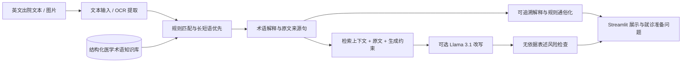
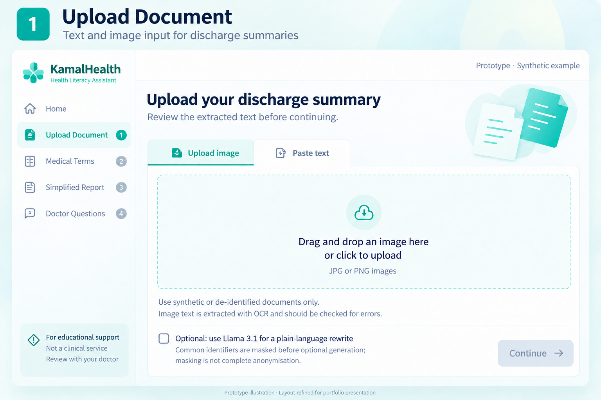
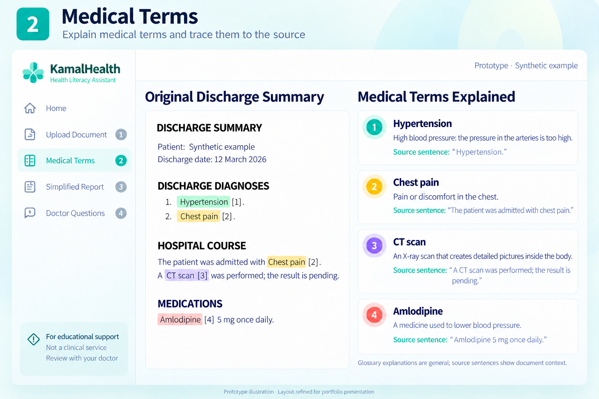
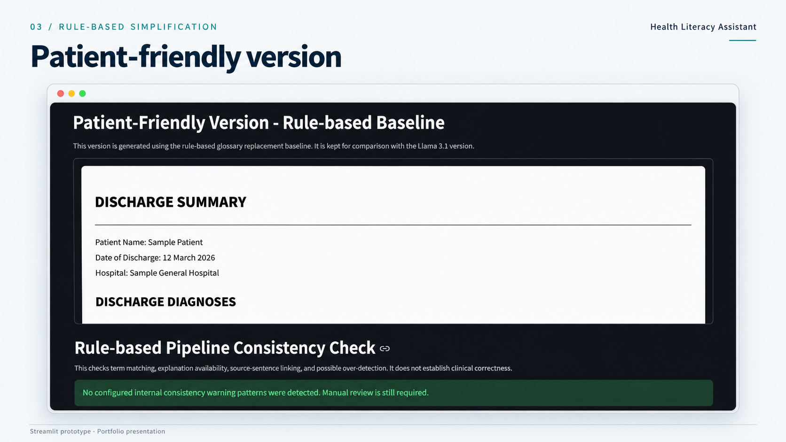
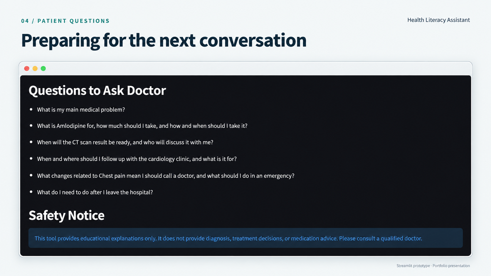

# KamalHealth AI｜医疗健康素养子模块

**AI 产品负责人｜2026.06–2026.09｜迪拜未来基金会支持项目**

围绕患者出院后「看懂医疗信息 → 理解关键内容 → 准备复诊沟通」的业务流程，推进医疗健康素养子模块从需求拆解、MVP 规划、RAG 方案设计到评测迭代及原型交付。

产品优先解决**医学术语解释与原文溯源**，将 Llama 3.1 通俗化改写作为辅助能力，帮助患者理解既有出院信息，并整理需要向医生确认的问题。

本仓库聚焦该子模块的产品决策、技术方案、AI 治理与交付验收，收录部分实现代码及界面展示。完整平台源码、知识库与内部评测明细不在公开展示范围内。

## 项目成果

| 评测指标 | 迭代前 | 迭代后 | 提升 |
| --- | ---: | ---: | ---: |
| 术语识别准确率 | 88% | **93%** | +5 个百分点 |
| 生成摘要的平均忠实度评分 | 80% | **87%** | +7 个百分点 |

以上为项目迭代评测结果；公开代码中的规则风险检查用于辅助复核，不直接计算这两项评分。

交付：**Streamlit 交互原型、产品与技术文档、评测迭代流程、验收标准及演示材料**。

## 我的职责与关键决策

| 职责 | 关键工作 | 决策与交付 |
| --- | --- | --- |
| **需求分析与产品规划** | 拆解术语理解、关键信息简化和就诊准备需求；综合用户价值、实施成本与医疗风险确定优先级。 | 先交付可解释、可追溯的术语解释，再提供受约束的生成式改写。[产品规划](docs/product-planning.md) |
| **RAG 技术选型与方案设计** | 围绕结构化医学术语知识库，选择规则匹配、知识检索与 Llama 3.1 相结合的方案。 | 将匹配到的术语解释作为生成上下文，平衡忠实度、可读性、响应成本与复杂度。[方案设计](docs/rag-design.md) |
| **AI 治理与效果迭代** | 建立覆盖术语识别、知识匹配与生成忠实度的 Baseline 评测及 Bad Case 追踪流程。 | 按知识匹配、文本处理和模型生成分类归因，迭代过滤规则与生成约束。[评测与迭代](docs/evaluation-and-iteration.md) |
| **研发协同与交付验收** | 明确模块接口、开发里程碑、阶段交付要求与验收标准，推进开发、联调、整改及复验。 | 围绕功能完整性、稳定性、信息可追溯性与异常处理完成交付。[交付与验收](docs/delivery-and-acceptance.md) |

## 结构化检索 RAG 方案

规则匹配从结构化术语库获得解释，再将解释与原文共同传给 Llama 3.1。基础解释可独立使用，可选生成承担自然语言改写。页面中的来源句链接用于核对输入文档；完整选型取舍见 [RAG 方案](docs/rag-design.md)。

技术组合：**Python · Streamlit · PaddleOCR · 规则匹配 / 结构化检索 · Llama 3.1 · Ollama**。

## 原型界面

以下是现有 Streamlit 子模块的界面展示，后续将结合新的项目网站素材更新。图片经过展示排版优化，功能与结果沿用原型。

### 文档输入

支持文本输入与图片上传；可选开启 Llama 3.1 改写，同时展示产品边界及输入隐私提示。

### 医学术语解释与原文溯源

将医学术语与通俗解释、原文位置和来源句对应，帮助用户核对解释依据。

### 通俗化文本与一致性检查

保留规则 Baseline 供对照，并展示内部一致性风险提示。

### 就诊准备

围绕原文内容整理复诊问题，并持续展示非诊疗工具的边界。

## 关键实现

可按 **[术语检索](code_samples/simplifier.py) → [生成上下文与约束](code_samples/grounded_rewrite_excerpt.py) → [生成风险检查](code_samples/faithfulness_check_excerpt.py)** 的顺序查看方案落地。

处理流程、隐私与界面样例的完整导航见 [代码阅读指南](code_samples/README.md)。样例用于说明关键实现，省略了部分模块与知识库。

## 局限与后续方向

产品面向非医学背景患者，解释英文出院材料中的已有信息，不提供诊断、治疗建议、用药调整或临床决策；演示使用合成或去标识化材料。

- 规则匹配仍可能出现语义歧义、漏匹配或过度识别，需要持续追踪 Bad Case。
- OCR 排版误差与长文本噪声可能传导至术语检索及改写。
- LLM 可能遗漏原文或加入无依据表述，生成约束与规则检查只能降低风险。
- 对常见标识的遮蔽无法保证完整匿名化。
- 原型的功能评测不构成临床验证；任何医疗决定仍需由具备资质的专业人员作出。
